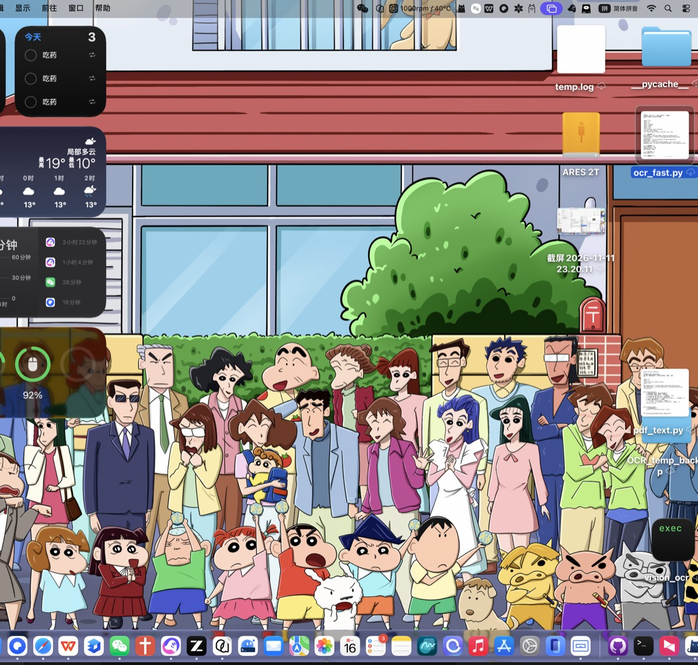

# iPad Sidecar Display

此 fork 基于原版 v2.4。自动连接只在 macOS 没有检测到在线实体屏、且虚拟屏已经建立后触发；存在实体屏时仍可在面板中手动连接 iPad。此版本不再用键鼠空闲、音频、锁屏或熄屏状态阻止无实体屏时的重连。

macOS 的在线列表包含休眠中的显示器。某些显示器关闭电源后依然显示为在线，此时软件仍会认为实体屏存在；如需进入无实体屏模式，可能需要断开显示线。系统显示器查询失败时，软件会等待下一轮检查。

把 iPad 变成 Mac 的主显示器，自动连接，失败不弹窗，**自带虚拟屏，不依赖 BetterDisplay**。

**English:** Automatically connect iPad as the main display when no physical monitor is online. When a physical monitor is online, automatic connection stays idle and manual connection remains available.

适合有时使用实体显示器、有时仅使用 iPad 的 Mac mini。

<p align="center">
  
</p>

<p align="center">
  
</p>

## 为什么做这个

macOS 的随航（Sidecar）功能本身很好用，但把它当**主显示器**用有几个麻烦：

1. 每次开机都要手动连一次
2. 连上后主屏还在 Mac 上，得去「系统设置 → 显示器」拖白条
3. **最烦的是连不上时疯狂弹窗**——iPad 没带在身边、深度休眠、或者关机，系统会弹一个「无法连接，发生了其他错误 (-1010)」，你点掉它，十秒后又弹一个

第三点尤其难受。实测过一个晚上：凌晨 1:51 到 8:03，连续失败 40 次，弹出 40 多个窗口。

这个工具解决的就是这三件事。

## 特性

- **自动连接**：没有在线实体屏时建立虚拟屏，连接 iPad 并设为主屏。
- **实体屏待命**：有在线实体屏时停止自动连接，面板保留手动连接。
- **弹窗兜底**：万一真失败，弹窗进程会在十秒内被清掉
- **菜单栏图标**：常驻菜单栏，点一下弹出面板（v2.1 起）。面板里手动连接、断开、暂停自动重连
- **自带 5K HiDPI 虚拟屏**：没有在线实体屏时，由辅助进程创建 2560×1440 逻辑 / 5120×2880 物理的虚拟屏。
- **虚拟屏开关**：面板支持手动开关，关闭前会提示可能影响随航。
- **面板挂了自动拉起**：watchdog 定期检查面板，虚拟屏由辅助进程持有。
- **通用二进制**：Apple Silicon 和 Intel 都支持

## 安装

### 安装此 fork

从本 fork 构建后，解压生成的 `iPad-Sidecar-Display-2.4.1.zip`，右键点击 `安装.command` 并选择「打开」。安装会覆盖现有的 iPad 随航应用和后台组件。

### 从源码构建

```bash
git clone https://github.com/LHY-1997/ipad-sidecar-display.git
cd ipad-sidecar-display
./build.sh
```

产出 `iPad-Sidecar-Display-2.4.1.zip`，解压后同样双击 `安装.command`。

需要 macOS 13+ 和 Xcode 命令行工具（`xcode-select --install`）。

运行 `./build.sh --test` 可构建独立的 Test 版安装包。Test 版使用不同的应用标识、配置目录和后台服务。安装会切换到 Test 模式，并暂停原版后台服务。安装包中的「恢复原版.command」可以切换回来。

**改版本号只改一处**：`build.sh` 顶部的 `VERSION`。zip 文件名和 app 的 `Info.plist` 都引用它，`CFBundleVersion` 自动取去掉小数点的形式（`2.4.1` → `241`）。面板左下角显示的 `v2.4.1` 是运行时从 `Info.plist` 读的，不用另外维护。

## 工作原理

### 连接与设主屏

私有框架 `SidecarCore.framework`：

```objc
SidecarDisplayManager *mgr = [SidecarDisplayManager new];
[mgr connectToDevice:device completion:^(NSError *e) { ... }];
```

设主屏用 CoreGraphics：主屏 = 原点在 (0,0)，把所有显示器整体平移，相对布局不变。

识别 iPad 靠 `CGDisplayModelNumber == 0x69506164`（ASCII 即 "iPad"）。

### 主屏归属规则

三块屏的优先级是定死的：

| 屏幕 | 能不能当主屏 |
|---|---|
| 实体屏 | ✅ 有实体屏时默认给它 |
| iPad 随航屏 | ✅ 有实体屏时手动选；**没有实体屏时自动就是它** |
| 虚拟屏 | ❌ 永远不行 |

分两种情况：

**有实体屏**——主屏归实体屏，iPad 要当主屏得手动点「设 iPad 为主屏」。守护只在主屏落到虚拟屏上时才动手，不抢你选好的。

**没有实体屏**（无头 Mac mini 之类）——iPad 是唯一合法主屏。只要 iPad 在，主屏就必须在它身上；启动时 iPad 还没连上的话，等它一连上就切过去。

虚拟屏是随航的落脚点，一建出来默认落在原点，会把主屏抢走。所以三层都做了守护：

- **建屏时**：`VirtualScreen.turnOn()` 延迟 1.8 秒按规则归位
- **面板**：`AppState.refresh()` 每 2 秒查一次，带 3 秒防抖
- **watchdog**：每 10 秒一轮，同一套规则

**watchdog 不再无条件抢主屏。** v2.2 之前它每 10 秒无条件把 iPad 设为主屏，用户手动切回实体屏后会被抢回去。v2.3 改成按规则来：有实体屏时你说了算，没有实体屏时 iPad 必须是主屏。

面板上的「主屏切回实体屏」按钮：主屏在虚拟屏上（异常）或 iPad 当主屏时出现，一键还给实体屏（没有实体屏时退回 iPad）。

### 自动连接条件

面板和 watchdog 共用在线显示器判断。有实体屏时不发起自动连接。无实体屏时先创建虚拟屏，确认系统已识别虚拟屏后再连接 iPad。连接前会再次检查实体屏是否已接入。

在无实体屏模式中，后台会按设定间隔重试，锁屏、熄屏或键鼠空闲不会单独阻止重连。可在面板中暂停自动重连。手动连接仍然可用，实体屏接入也不会主动断开已有随航连接。

### 弹窗拦截

弹窗的进程不是 `SidecarDisplayAgent`，而是 **`UserNotificationCenter`**。这点搞错很久——早期版本一直盯着 `SidecarDisplayAgent` 杀，从来没生效过。另有一个叫 `NotificationCenter` 的进程是桌面通知小组件，中文系统下 owner 名显示为「通知中心」，别搞混。

为什么只能杀不能点：点「好」按钮需要 AppleScript 或 Accessibility API。实测在 LaunchAgent 环境下两者都没权限——`AXIsProcessTrusted()` 返回 `false`，`AXUIElementCopyAttributeValue` 返回 `-25211`，只有从终端直接跑才有。所以走 `killall UserNotificationCenter`。

副作用是连带清掉当前所有通知横幅。但该进程按需启动，不会立刻自拉起，下次真有通知时 launchd 会重新拉它，系统不受影响。

识别方式是扫 `CGWindowListCopyWindowInfo`（只读窗口 owner，不需要屏幕录制权限），按尺寸过滤：Sidecar 弹窗实测 260×218，普通通知横幅更扁（高度通常不到 120），桌面层窗口是全屏尺寸，都不落在 200–500 × 120–400 区间里。

两个触发点：

- watchdog 每次运行开头扫一遍，清掉残留弹窗（比如手动点菜单栏连接失败留下的）
- 连接流程中每 0.2 秒扫一遍，一出现就杀

这是最后一道保险，正常路径下不该触发。

### 单实例锁

一次连接流程最长 35 秒（等回调 20 秒 + 等屏出现 15 秒），而 LaunchAgent 每 10 秒拉一个新进程。用 `flock` 锁住 `.lock` 文件，保证同时只有一个实例在跑。

### 虚拟屏（由辅助进程持有）

无头 Mac mini 没有物理屏幕，开机后如果没有虚拟显示器，WindowServer 就没地方画桌面，随航也无从接管。

传统做法是装 BetterDisplay，但它 88 MB 内存只为了建一块假屏。现在 `iPad随航.app` 启动辅助进程，调用 `CGVirtualDisplay` 私有 API 创建虚拟屏。

**开关在面板里，没有在线实体屏时自动开启。** 关掉会弹警告，随航连接可能中断。手动关闭虚拟屏后，自动连接会等待虚拟屏重新启用。

开关状态记在 `~/Library/Application Support/ipad-watchdog/vdisplay.off`：文件存在 = 关闭，不存在 = 开启。所以想强制恢复默认，删掉这个文件重启即可。

四个私有类都在 **CoreGraphics** 里（不是 `CoreDisplay`）：

```
CGVirtualDisplay
CGVirtualDisplayDescriptor
CGVirtualDisplayMode
CGVirtualDisplaySettings
```

系统 framework 在 dyld shared cache 里，磁盘上的文件只是 stub，`nm`/`strings` 读不到。要看谁导入了这些类，用：

```bash
dyld_info -imports /Applications/BetterDisplay.app/Contents/MacOS/BetterDisplay | grep VirtualDisplay
```

编译期不链接私有框架，运行时用 `NSClassFromString` + ObjC runtime 反射调用（跟 watchdog 处理 `SidecarCore` 是同一套路）。

**HiDPI 的正确姿势**（踩坑最深的一处）：

| 注册分辨率 | `setHiDPI` | 结果 |
|---|---|---|
| 5120×2880 | 1 | ❌ 逻辑=物理=5120，1x，UI 小到不可用，ioFlags `0x2000003` |
| **2560×1440** | **1** | ✅ 系统自动派生 HiDPI，逻辑 2560 / 物理 5120，ioFlags `0x2000007` |

也就是说，**注册逻辑分辨率，让系统去翻倍**，不是注册物理分辨率。

另外 `CGDisplayCopyAllDisplayModes` 默认列表**不含** HiDPI 变体，必须传：

```swift
let opts = [kCGDisplayShowDuplicateLowResolutionModes as String: true] as CFDictionary
```

**由辅助进程持有虚拟屏**：关闭虚拟屏时辅助进程退出，系统随后移除对应显示器。

**面板退出时**，辅助进程也随之退出。watchdog 会根据面板退出状态决定是否重新启动面板。

区分「崩了」和「用户主动退出」靠 `panel.off`：面板的「退出」按钮在虚拟屏开着时会先弹警告（说明退出会连虚拟屏一起关掉、随航会断），确认后写 `panel.off` 再退出；下次面板启动时自动删掉这个标记。watchdog 看到 `panel.off` 就不干预。

**旧版遗留的两个坑**（2.0 之前虚拟屏是独立进程 `ipad-vdisplay`，如果以后改回独立进程会再遇到）：

1. `KeepAlive` 配 `SuccessfulExit=false` 时，进程收到 SIGTERM 后 `exit(0)` 会被判定为"正常完成"，launchd **不会重启**。信号处理器里要 `exit(1)`。
2. `lipo` 拼接通用二进制会**丢失签名**，launchd 报 `OS_REASON_CODESIGNING` 拒绝启动。必须 `codesign --force -s -` 重签。

实测参数（跟 BetterDisplay 建的屏逐字节一致）：

```
逻辑 2560×1440 / 物理 5120×2880 / 60Hz / ioFlags 0x2000007
```

分辨率写死在 `Sources/VirtualScreen.swift` 顶部的 `logicalW` / `logicalH`，改配置需重编译。

## 关于 -1010 和 -501

弹窗里见过两个错误码：`-1010`（A miscellaneous error occurred）和 `-501`，都表示连不上。

这个错误码让人困惑很久。一开始以为是 iPad 锁屏导致的，后来实测发现 **iPad 锁屏完全不影响连接**——Sidecar 会主动唤醒 iPad 并接管显示。

真正的失败原因是：

- iPad 不在蓝牙范围内
- iPad 深度休眠，无线响应超时
- iPad 关机或电量耗尽

**`SidecarDevice` 的 12 个 ivar 里没有任何可用性字段**（没有 `isAvailable`、`isConnected`、`connectionState`），所以"检查设备能不能连"这个动作本身必然等于"真的发起连接"，不存在免费的前置探测。本 fork 只在没有在线实体屏时尝试自动连接。

## 配置

配置文件都在 `~/Library/Application Support/ipad-watchdog/`：

| 文件 | 作用 |
|---|---|
| `pause` | 存在即暂停守护（菜单栏也能开关） |
| `target` | 指定优先连接的设备 UUID |
| `watchdog.log` | 日志，只在有事件时写 |
| `vdisplay.log` | 虚拟屏日志（建屏、切 HiDPI、开关） |
| `vdisplay.off` | 当前运行中手动关闭虚拟屏的标记，面板重启时清除 |
| `panel.off` | 存在 = 用户主动退出了面板，watchdog 不再拉起；重新打开面板会自动清掉 |

自检（显示屏幕和键鼠状态，此 fork 不用这些状态决定自动连接）：

```bash
~/Library/Application Support/ipad-watchdog/ipad-here
# 屏幕亮=是 已锁屏=否 有音频=否 空闲=13.5秒 → 人在=是
```

## 卸载

双击 `卸载.command`，或运行 `Packaging/uninstall.sh`。

## 已知限制

- 使用私有框架 `SidecarCore`，macOS 大版本更新可能失效。失效表现：日志持续记「SidecarCore 加载失败」
- app 是 adhoc 签名，首次打开会被 Gatekeeper 拦，需要右键打开
- 虚拟屏用私有 API `CGVirtualDisplay`（来自 CoreGraphics），macOS 大版本更新可能失效。失效表现：`vdisplay.log` 记「私有类缺失」
- 虚拟屏分辨率写死在 `Sources/VirtualScreen.swift` 顶部（`logicalW` / `logicalH`），改配置需重编译
- 手动关闭虚拟屏可能中断随航。重新开启虚拟屏后才能继续自动连接。
- 只测过 iPad Pro 12.9"（M1）和 macOS 26/27，其他组合未验证

## License

MIT
